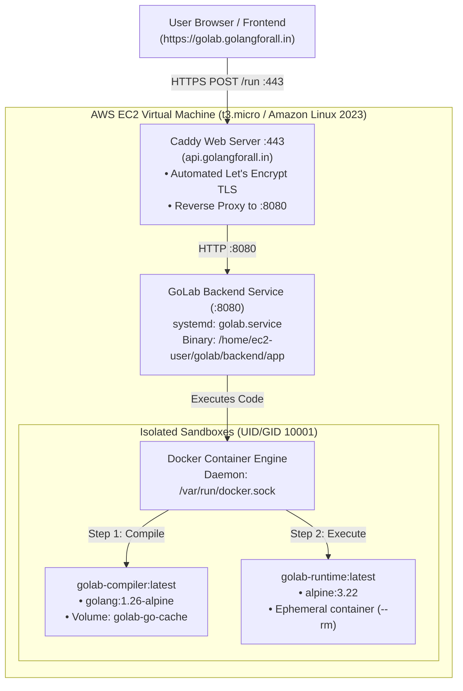

# GoLab Backend — Complete AWS EC2 Deployment & Disaster Recovery Guide

> **CRITICAL NOTICE:** Your active AWS account (`196591916069`) is scheduled to expire in approximately **25 days**. This document contains everything needed to reconstruct, redeploy, or migrate the live GoLab Backend service to **any new AWS account or cloud VPS provider (DigitalOcean, Hetzner, Linode, GCP, Azure)** in under 5 minutes without losing any configurations or code.

All live server assets, configurations, and scripts from the running EC2 instance (`i-01f086c5a44746100`) have been safely backed up in the [`ec2-deployment/`](file:///c:/Users/dhawa/OneDrive/Desktop/code/golab/ec2-deployment) directory of this repository.

---

## 1. System Architecture Overview

The live GoLab production backend operates under a **Reverse-Proxy Containerized Sandbox** architecture:



### Live Server Blueprint
- **Compute:** AWS EC2 `t3.micro` (2 vCPU, 1 GB RAM, 30 GB EBS gp3 volume)
- **Operating System:** Amazon Linux 2023 (AL2023) 64-bit x86_64
- **Public Domain:** `https://api.golangforall.in`
- **Frontend Origin:** `https://golab.golangforall.in`
- **Reverse Proxy:** Caddy v2 (automatic zero-config SSL certificates via ACME/Let's Encrypt)
- **Backend Application:** Go 1.22+ (`/home/ec2-user/golab/backend/app`) listening on `127.0.0.1:8080`
- **Sandbox Security:** Docker rootless/unprivileged user `10001:10001` with ephemeral volumes

---

## 2. Quickstart: 1-Command Automated Bootstrap (New Server)

If you launch a fresh Amazon Linux 2023 instance on a new AWS account, run this single command to bootstrap the entire server automatically:

```bash
# 1. SSH into the fresh instance
ssh -i /path/to/new-key.pem ec2-user@<NEW_EC2_PUBLIC_IP>

# 2. Download and run the turnkey bootstrap script
curl -sSL https://raw.githubusercontent.com/DhawalShankar/golab/main/ec2-deployment/bootstrap_ec2.sh | bash
```

The script will automatically install Go, Docker, Caddy, build the compiler/runtime sandboxes, install systemd services, and start the runner.

---

## 3. Step-by-Step Manual Rebuilding on a New AWS Account

Follow these steps if you want to set up the server manually via the AWS Console and CLI.

### Step 1: Launch EC2 Instance in AWS Console
1. Log in to your new AWS Management Console.
2. Navigate to **EC2** -> **Instances** -> **Launch Instances**.
3. Configure the instance parameters:
   - **Name:** `GoLab-Runner`
   - **Application and OS Images:** `Amazon Linux 2023 AMI` (Kernel 6.1, 64-bit x86)
   - **Instance Type:** `t3.micro` (Free-tier eligible) or `t4g.micro` (ARM64)
   - **Key Pair:** Create or select a `.pem` key pair (e.g. `golab-key.pem`)
4. **Network Settings (Security Group):**
   Create a Security Group with the following inbound rules:
   | Protocol | Port | Source | Purpose |
   |---|---|---|---|
   | TCP | `22` | Your IP or `0.0.0.0/0` | SSH Administration |
   | TCP | `80` | `0.0.0.0/0` | Caddy HTTP (ACME challenge & HTTPS redirect) |
   | TCP | `443` | `0.0.0.0/0` | Caddy HTTPS (Public API Ingress) |
5. **Storage:** 15 GB to 30 GB `gp3` root volume.
6. Click **Launch Instance**.

### Step 2: Allocate and Attach an Elastic IP (Crucial!)
To prevent your server's IP address from changing on reboot:
1. In the EC2 Console left sidebar, click **Elastic IPs**.
2. Click **Allocate Elastic IP address** -> **Allocate**.
3. Select the allocated Elastic IP -> **Actions** -> **Associate Elastic IP address**.
4. Choose your new `GoLab-Runner` instance and click **Associate**.
5. Note this IP (e.g. `X.X.X.X`).

### Step 3: Connect via SSH
On your local terminal:
```bash
# Set secure permissions on private key
chmod 400 ~/.ssh/golab-key.pem

# SSH into the server
ssh -i ~/.ssh/golab-key.pem ec2-user@<YOUR_ELASTIC_IP>
```

### Step 4: Install System Dependencies
Update packages and install Golang and Git:
```bash
sudo dnf update -y
sudo dnf install -y golang git

# Verify
go version
git --version
```

### Step 5: Install & Configure Docker
Install Docker engine and allow `ec2-user` to run containers without `sudo`:
```bash
sudo yum install -y docker
sudo systemctl enable --now docker
sudo usermod -aG docker ec2-user

# Reload shell group permissions
newgrp docker

# Verify Docker
docker info
```

### Step 6: Install Caddy Web Server (Reverse Proxy & Free SSL)
Install Caddy for automated HTTPS certificates:
```bash
cd /tmp
curl -sL -o caddy 'https://caddyserver.com/api/download?os=linux&arch=amd64'
chmod +x caddy
sudo mv caddy /usr/bin/caddy
sudo mkdir -p /etc/caddy

# Create system caddy user
sudo groupadd --system caddy
sudo useradd --system \
    --gid caddy \
    --create-home \
    --home-dir /var/lib/caddy \
    --shell /usr/sbin/nologin \
    --comment "Caddy web server" \
    caddy
sudo chown -R caddy:caddy /etc/caddy

# Verify
caddy version
```

### Step 7: Clone the GoLab Repository
Generate an SSH key or clone via HTTPS:
```bash
cd /home/ec2-user
git clone https://github.com/DhawalShankar/golab.git
cd /home/ec2-user/golab
```

### Step 8: Compile the Go Backend
```bash
cd /home/ec2-user/golab/backend
go mod download
go build -o app .

# Ensure deploy.sh is executable
chmod +x deploy.sh
```

### Step 9: Build Docker Sandbox Images
The backend requires two local Docker images to compile and run untrusted code safely:
```bash
cd /home/ec2-user/golab/backend

# 1. Build Compiler Sandbox (golang:1.26-alpine base)
docker build -t golab-compiler:latest -f sandbox/compiler.Dockerfile .

# 2. Build Runtime Sandbox (alpine:3.22 base)
docker build -t golab-runtime:latest -f sandbox/runtime.Dockerfile .

# 3. Create persistent Go build cache volume
docker volume create golab-go-cache

# 4. Initialize cache permissions for non-root user 10001
docker run --rm \
    -u 0 \
    -v golab-go-cache:/gocache \
    alpine:3.22 \
    sh -c "chown -R 10001:10001 /gocache"

# Verify images are built
docker images
```

### Step 10: Configure `golab.service` Systemd Unit
Create the service to manage the Go backend with automatic restarts on crash or reboot:
```bash
sudo tee /etc/systemd/system/golab.service > /dev/null << 'EOF'
[Unit]
Description=GoLab Runner
After=network.target

[Service]
Type=simple
User=ec2-user
WorkingDirectory=/home/ec2-user/golab/backend

ExecStart=/home/ec2-user/golab/backend/app

Restart=always
RestartSec=3

Environment=PORT=8080
Environment=FRONTEND_URL=https://golab.golangforall.in

[Install]
WantedBy=multi-user.target
EOF

# Reload systemd and start GoLab
sudo systemctl daemon-reload
sudo systemctl enable --now golab
sudo systemctl status golab --no-pager
```

### Step 11: Configure Caddy (`Caddyfile` and `caddy.service`)
Configure Caddy to forward incoming traffic from `api.golangforall.in` to `localhost:8080`:

```bash
# 1. Write Caddyfile
sudo tee /etc/caddy/Caddyfile > /dev/null << 'EOF'
api.golangforall.in {
    reverse_proxy localhost:8080
}
EOF

# 2. Write caddy.service
sudo tee /etc/systemd/system/caddy.service > /dev/null << 'EOF'
[Unit]
Description=Caddy
Documentation=https://caddyserver.com/docs/
After=network.target network-online.target
Requires=network-online.target

[Service]
Type=notify
User=caddy
Group=caddy

ExecStart=/usr/bin/caddy run --environ --config /etc/caddy/Caddyfile
ExecReload=/usr/bin/caddy reload --config /etc/caddy/Caddyfile

TimeoutStopSec=5s
LimitNOFILE=1048576

PrivateTmp=true
ProtectSystem=full

AmbientCapabilities=CAP_NET_ADMIN CAP_NET_BIND_SERVICE

[Install]
WantedBy=multi-user.target
EOF

# 3. Enable and start Caddy
sudo systemctl daemon-reload
sudo systemctl enable --now caddy
sudo systemctl status caddy --no-pager
```

### Step 12: Update DNS Records
1. Go to your Domain Registrar or DNS Provider (Route 53, Cloudflare, Namecheap, GoDaddy).
2. Locate the DNS records for `golangforall.in`.
3. Update the **A Record** for `api.golangforall.in`:
   - **Type:** `A`
   - **Host / Name:** `api`
   - **Value / Target:** `<NEW_ELASTIC_IP>`
   - **TTL:** `300` (5 minutes)
4. Caddy will detect the new IP, automatically initiate the Let's Encrypt TLS handshake on port 80/443, and activate your HTTPS certificate within 60 seconds!

---

## 4. Verification & Testing

Verify that your new server is running correctly:

### Test 1: Internal Health Check (from EC2 terminal)
```bash
curl http://localhost:8080/health
# Expected: 200 OK
```

### Test 2: Local Code Execution Test
```bash
curl -X POST http://localhost:8080/run \
  -H "Content-Type: application/json" \
  -d '{"code":"package main\nimport \"fmt\"\nfunc main(){fmt.Println(\"Hello from New Server!\")}", "input":""}'
```

### Test 3: Public HTTPS Endpoint Test (from your laptop)
```bash
curl -X POST https://api.golangforall.in/run \
  -H "Content-Type: application/json" \
  -d '{"code":"package main\nimport \"fmt\"\nfunc main(){fmt.Println(\"GoLab Live Migration Verified\")}", "input":""}'
```

---

## 5. Ongoing Updates & CI/CD (`deploy.sh`)

Whenever you push new Go backend code to GitHub, SSH into your server and run:

```bash
cd ~/golab/backend
./deploy.sh
```

The script will automatically:
1. `git pull --ff-only origin main`
2. Recompile the binary `app`
3. Verify cache volume permissions
4. Restart `golab.service` with zero hassle

---

## 6. Backup Files Inventory

All configuration files extracted from the live VM are preserved in this repository:

| File Path | Description |
|---|---|
| [`backend/deploy.sh`](file:///c:/Users/dhawa/OneDrive/Desktop/code/golab/backend/deploy.sh) | The production build, cache chown, and restart script |
| [`ec2-deployment/golab.service`](file:///c:/Users/dhawa/OneDrive/Desktop/code/golab/ec2-deployment/golab.service) | Systemd unit configuration for GoLab Runner |
| [`ec2-deployment/Caddyfile`](file:///c:/Users/dhawa/OneDrive/Desktop/code/golab/ec2-deployment/Caddyfile) | Reverse proxy configuration for `api.golangforall.in` |
| [`ec2-deployment/caddy.service`](file:///c:/Users/dhawa/OneDrive/Desktop/code/golab/ec2-deployment/caddy.service) | Systemd service definition for Caddy |
| [`ec2-deployment/bootstrap_ec2.sh`](file:///c:/Users/dhawa/OneDrive/Desktop/code/golab/ec2-deployment/bootstrap_ec2.sh) | Turnkey 1-command bootstrap script for any fresh VM |
| [`ec2-deployment/vm_system_spec.json`](file:///c:/Users/dhawa/OneDrive/Desktop/code/golab/ec2-deployment/vm_system_spec.json) | Detailed JSON hardware and network telemetry specification |
| [`ec2-deployment/vm_bash_history.log`](file:///c:/Users/dhawa/OneDrive/Desktop/code/golab/ec2-deployment/vm_bash_history.log) | Complete raw bash command history from the original VM |
